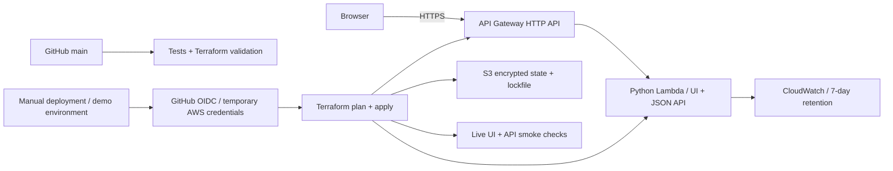

# Release Gate — Terraform + GitHub Actions + AWS

[](https://github.com/FrancoJim/portfolio-release-gate/actions/workflows/ci.yml)

A small release-readiness app with a repeatable infrastructure and delivery path. The browser sends four boolean checks to a Python API. The API returns missing controls; it stores no submissions and makes no external calls.

**Deployment status:** source and CI are independent of cloud access. A live AWS deployment has not yet been verified. Do not describe this sample as a production deployment or a client engagement. See the Deploy demo workflow for the live URL after an approved deployment completes.



## Why this shape

The app is deliberately small so a reviewer can follow the complete deployment path. Lambda avoids maintaining a demo VM or cluster. Terraform defines the runtime identity, logs, application archive, HTTP gateway, throttling, and invoke permission. The runtime role can write only its own logs. Deployment uses a separate role. PR validation receives no AWS identity; deployment is a manual action on main through the `demo` environment.

This is a portfolio baseline, not a full production platform: no database, user authentication, WAF, custom domain, SLO paging, or high-volume load test. The public app must receive demo data only. Throttling limits request rate but is not a hard spending cap.

## Run checks

Python 3.12, Node, and Terraform 1.12.2:

```sh
python -m unittest discover -s tests -v
node --check app/app.js
terraform fmt -check -recursive
terraform -chdir=infra init -backend=false
terraform -chdir=infra validate
```

No application package installation is required. CI performs the same checks. Provider versions are recorded in `infra/.terraform.lock.hcl`.

## API

- `GET /`: interactive checklist.
- `GET /app.js`: browser behavior.
- `GET /health`: `{"status":"ok"}`.
- `POST /api/check`: exactly `tests_passed`, `rollback_ready`, `backup_verified`, `owner_assigned`, each a boolean. Returns readiness, count, and missing controls.
- Bad JSON/schema: 400. Oversized body: 413. Unknown route: 404. Wrong API method: 405.

## Deployment, recovery, and cost

Follow [the setup runbook](docs/deploy.md). Deployment requires an AWS account, a state bucket, an OIDC role, and approval for usage charges. No resources are created by ordinary CI. The app contains no customer data and does not log submitted bodies.

After deployment, `python scripts/smoke.py URL` verifies the homepage, health route, and a real calculation. The deployment job fails if these checks fail. Terraform apply is not automatically rolled back; inspect the failure and use the documented recovery path.

[Three-minute walkthrough script](docs/loom-script.md).

## References

The authentication pattern follows [GitHub's AWS OIDC guide](https://docs.github.com/en/actions/how-tos/secure-your-work/security-harden-deployments/oidc-in-aws). The HTTP API uses the [HashiCorp AWS API Gateway v2 resource](https://registry.terraform.io/providers/hashicorp/aws/latest/docs/resources/apigatewayv2_api).
