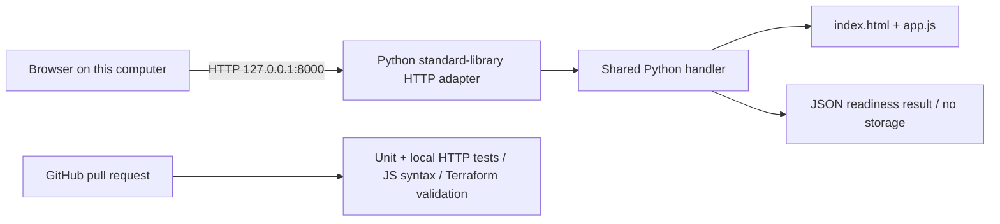

# Release Gate — local portfolio demo

[](https://github.com/FrancoJim/portfolio-release-gate/actions/workflows/ci.yml)

A small release-readiness app. The browser sends four boolean checks to a Python API, which returns missing controls. Submissions are not stored and the app makes no external calls. This is a portfolio sample, not a client engagement or production release approval.

## Fresh-checkout startup

Requires Python 3.12 or newer and Git. No packages, AWS account, cloud credentials, or services are needed. From a terminal:

```sh
git clone https://github.com/FrancoJim/portfolio-release-gate.git
cd portfolio-release-gate
python3 -m app.local
```

Open http://127.0.0.1:8000. Leave rollback unchecked and submit, then check all four controls and submit again. Stop with Ctrl-C. The server binds only to IPv4 loopback; it has no public-bind option. If port 8000 is occupied, use `python3 -m app.local --port 8001` and change the URL below accordingly. This standard-library server is for local demonstration, with no authentication or persistence.

In another terminal, from the repository root:

```sh
python3 scripts/smoke.py http://127.0.0.1:8000
python3 -m unittest discover -s tests -v
node --check app/app.js
```

Smoke checks verify homepage, health, all-ready, rollback-missing, and invalid input (HTTP 400). Node is needed only for the JavaScript syntax check. CI uses Python 3.12 and runs these application checks plus the retained Terraform validation.

## Local architecture



The local adapter translates HTTP requests into the existing handler input, so the UI and checklist rules share one implementation. It bounds request bodies and preserves the handler's security headers. No database, external API, cloud logs, or cloud runtime participates in this path.

## API

- `GET /`: interactive checklist.
- `GET /app.js`: browser behavior.
- `GET /health`: `{"status":"ok"}`.
- `POST /api/check`: exactly `tests_passed`, `rollback_ready`, `backup_verified`, `owner_assigned`, each a boolean. Returns readiness, count, and missing controls.
- Bad JSON/schema: 400. Oversized body: 413. Unknown route: 404. Wrong API method: 405.

[Three-minute local walkthrough script](docs/loom-script.md).

## Optional AWS examples — unexecuted

`infra/`, `bootstrap/`, `.github/workflows/deploy.yml`, and [the AWS runbook](docs/deploy.md) are retained reference examples. AWS deployment has not been verified and is outside the approved local demo. Do not run apply or dispatch deployment without separate authorization and spending approval. Existing sales materials remain valid; no cloud deployment is claimed.

CI validates these examples without cloud credentials or applying resources. To repeat that optional validation, install Terraform 1.12.2 (provider downloads need network access):

```sh
terraform fmt -check -recursive
terraform -chdir=infra init -backend=false -input=false
terraform -chdir=infra validate
terraform -chdir=bootstrap init -input=false
terraform -chdir=bootstrap validate
```
